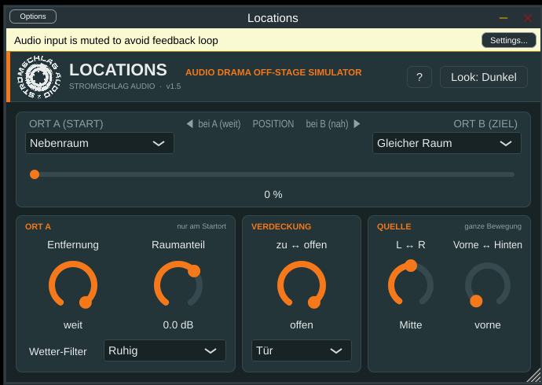
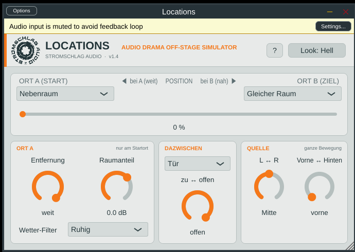

# LOCATIONS – Audio Drama Off-Stage Simulator

<picture>
  <source media="(prefers-color-scheme: dark)" srcset="docs/kopf-dunkel.png">
  
</picture>

VST3-Effekt für Hörspiel-Produktion. Er lässt eine Stimme oder ein Geräusch so klingen, als käme es aus
einem anderen Raum, einer anderen Etage, hinter einer geschlossenen Tür oder aus der Ferne im Freien –
und lässt es mit **einem** automatisierbaren Regler von dort heranrücken.

## Warum es dieses Plugin gibt

Bei meiner langjährigen Arbeit an Hörspielproduktionen habe ich immer wieder die Erfahrung gemacht, dass die
Skripte Szenen enthalten, in denen Stimmen aus einiger Entfernung oder aus einem anderen Raum zu hören sind:
Eine Figur ruft aus dem oberen Stockwerk und kommt die Treppe herunter. Jemand spricht hinter einer geschlossenen
Tür, die sich langsam öffnet. Oder ein Suchtrupp ruft im nächtlichen Wald nach einem Vermissten und kommt hörbar näher.

Für solche Szenen habe ich jedes Mal Plugin-Ketten gebaut: EQ, Filter, Hall, Delay und doppelte Spuren mit
Überblendungen. Bis alles glaubwürdig klang, wurde es oft verschachtelt und mühsam.

Irgendwann fiel mir auf, dass es meist um eine überschaubare Anzahl wiederkehrender Situationen geht. Daraus
entstand die Idee für ein einziges Werkzeug: LOCATIONS. Kein Gimmick, sondern ein Alltagswerkzeug für meinen
eigenen Workflow – für jede Sprecher- oder SFX-Spur.

Mit LOCATIONS lässt sich eine Quelle an einem Ort platzieren: tief im Wald, hinter einer geschlossenen Tür oder
im Keller. Sie lässt sich aber auch in Bewegung setzen, etwa wenn jemand aus dem Nebenraum hereinkommt oder ein
Suchtrupp im Wald näher rückt. Diese Bewegung wird über Automation in der DAW gesteuert – im Wesentlichen mit dem
Regler „Position (A nach B)“. Für weitere Veränderungen, etwa das Öffnen einer Tür, gibt es eigene Regler, die sich
ebenfalls automatisieren lassen.

LOCATIONS ist bewusst für Stereo-Hörspiele gemacht. Für Surround- oder binaurale Produktionen gibt es andere
Lösungen. Hier geht es darum, räumliche Szenen im Stereobild einfach und schnell umzusetzen – ohne jedes Mal
eine ganze Kette von Plugins aufzubauen.

– Lars Eickstädt, Stromschlag Audio

**⬇ Download (Windows, VST3):** https://github.com/StromschlagProductions/Locations-vst/releases/latest

## Oberfläche

| Dunkel (Standard) | Hell |
|---|---|
|  |  |

Der Umschalter oben rechts wechselt den Look, die Wahl wird mit dem Projekt gespeichert. Der **?**-Knopf
öffnet die Hilfe, über jedem Regler erscheint beim Darüberfahren ein kurzer Hinweis.

Die Oberfläche lässt sich am rechten unteren Fensterrand stufenlos von 50 % bis 300 % vergrößern oder
verkleinern. Das Seitenverhältnis bleibt dabei fest.

## So ist es gedacht

- **Ort A** ist der Ort, an dem die Quelle anfängt (z. B. Obere Etage, Wald).
- **Ort B** ist das Ziel, fast immer **Gleicher Raum** – der Raum, in dem die Zuhörer sitzen. Ort B ist immer „nah“.
- **Position** ist der eine Regler, den du automatisierst: 0 % = bei Ort A, 100 % = bei Ort B.
  Auf dem Weg dahin werden Klangfarbe, Lautstärke, Hall, Echo und Laufzeit gleitend von A nach B überführt.
- **Entfernung A** legt vorher fest, wie weit weg Ort A ist. So kannst du die Position immer von ganz links
  nach ganz rechts fahren und bestimmst trotzdem, ob der Suchtrupp tief im Wald oder hinter den nächsten Bäumen anfängt.

Den Hall deines Hörraums (z. B. Wohnzimmer-Impulsantwort) legst du wie gewohnt danach in der DAW darüber.

## Orte

**Innen**

| Ort | Wann nehmen | Klang |
|---|---|---|
| Gleicher Raum | Die Figur ist im selben Raum wie die Zuhörer | Kein Effekt (nur bei Entfernung leicht dunkler und leiser) |
| Nebenraum | Durch eine Wand nebenan | Dumpfer, etwas Hall |
| Flur | Im Flur vor dem Raum | Heller als Nebenraum, mehr Hall |
| Treppenhaus | Auf der Treppe | Mittlerer, längerer Hall |
| Obere Etage | Oben, durch die Decke | Dumpf, leise, kurzer Hall |
| Dachboden | Unterm Dach | Dumpf, kurzer, trockener Raum |
| Keller | Unten im Keller | Dumpf, lang nachhallend |
| Badezimmer | Gekachelter kleiner Raum nebenan | Kurzer, heller, harter Hall |
| Große Halle | Weitläufiger Innenraum | Viel Hall, kaum Höhenverlust |
| Tunnel / Höhle | Tunnel, Stollen, Höhle | Sehr langer, harter Nachhall |

**Draußen** (kein Raumhall, sondern Höhenverlust mit der Entfernung und Echos)

| Ort | Wann nehmen | Klang |
|---|---|---|
| Draußen: Feld | Offene Fläche, Steppe, Outback | Kein Hall, nur Höhen- und Pegelverlust |
| Draußen: Wald | Im Wald, zwischen Bäumen | Kein Hall, weiches dumpfes Echo aus der Ferne |
| Draußen: Straße | Zwischen Häusern | Kurzes Echo von den Hauswänden, etwas Raum |
| Draußen: Schlucht / Felswand | Berge, Steinbruch, Felswand | Langes, wiederholtes Echo |

Die Laufzeit des Weges (ein paar Millisekunden innen, mehr draußen) und das Leiserwerden mit der Entfernung
passieren automatisch.

## Regler (alle automatisierbar)

**Oben**

| Regler | Wirkung |
|---|---|
| Ort A / Ort B | Start und Ziel der Bewegung |
| Position (A nach B) | **der Regler für die Bewegung**: 0 % = bei Ort A, 100 % = bei Ort B (nah) |

**Unten, in drei Kästen**

| Kasten | Regler | Wirkung |
|---|---|---|
| **ORT A** – wirkt nur am Startort | Entfernung | wie weit weg Ort A ist (nah – weit) |
| | Raumanteil | mehr oder weniger Hall bzw. Echo von Ort A (Feinregler, normalerweise 0 dB) |
| | Wetter-Filter | Ruhig, Wind, Regen, Sturm. **Ändert nur den Klang, erzeugt keine Wind- oder Regengeräusche.** Nur wenn Ort A draußen ist: Höhen werden geschluckt, Böen lassen Rufe schwanken. Stärker mit der Entfernung, verschwindet zu Ort B hin |
| **VERDECKUNG** – etwas, das sich zwischen Quelle und Hörer stellt; unabhängig von der Position | Art | Tür, Fenster (gekippt ≈ Mitte), Vorhang oder Autoscheibe |
| | zu ↔ offen | zu = dumpf und leise mit dem Klang des Hindernisses, offen = keine Wirkung. Die Tür bleibt zu, bis du sie öffnest – auch wenn die Quelle schon bei Ort B ist |
| **QUELLE** – gilt für die ganze Bewegung | L ↔ R | Panorama der Quelle (Stimme, Schritte, Geräusch auf der Spur). Nur die Quelle wandert, Hall und Echo bleiben in der Mitte – anders als beim Pan am Kanal |
| | Vorne ↔ Hinten | hinter dem Hörer klingt die Quelle etwas dunkler. Hall und Echo bleiben gleich |

## Anwendung

**Treppe herunter:** Ort A = Obere Etage, Ort B = Gleicher Raum. Position von 0 auf 100 % ziehen,
zu dem Zeitpunkt, an dem die Figur losgeht. Stimme, Schritte usw. am besten auf einen gemeinsamen Bus mit dem Plugin legen.

**Suchtrupp im Wald kommt näher:** Ort A und B = Draußen: Wald, Entfernung A = weit. Position von 0 auf 100 % ziehen.
Ist der Trupp nur ein paar Bäume entfernt: Entfernung A auf etwa 40 %.

**Jemand geht weg:** wie oben, nur die Position von 100 auf 0 % ziehen.

**Vor der geschlossenen Tür:** Ort A = Flur, Ort B = Gleicher Raum, Position auf 0 %, Verdeckung = Tür, Regler auf „zu“.
Geht die Tür auf: zu ↔ offen aufziehen, danach ggf. die Position, wenn die Figur hereinkommt.

**Jemand spricht von außen ins Auto:** Ort A und B = Gleicher Raum (oder Draußen: Straße), Verdeckung = Autoscheibe,
Regler auf „zu“. Kurbelt jemand die Scheibe herunter: zu ↔ offen aufziehen.

**Ruf über das Feld bei Sturm:** Ort A = Draußen: Feld, Entfernung A = weit, Wetter-Filter = Sturm. Position von 0 auf 100 %:
Aus der Ferne kommen nur Fetzen durch, je näher er kommt, desto verständlicher.

**Ruf aus der Schlucht:** Ort A und B = Draußen: Schlucht / Felswand, Entfernung A = weit, Position auf 0 % lassen.

## Installation (Windows)

1. Über den Download-Link oben `Locations-VST3-Windows.zip` laden.
2. ZIP entpacken und den **ganzen Ordner** `Locations.vst3` nach `C:\Program Files\Common Files\VST3` kopieren.
3. DAW neu starten bzw. Plugins neu scannen.

## Versionen

Die Versionsnummer steht in der Datei `VERSION`, im Plugin-Kopf und im Namen der Release. Sie wird bei jeder Änderung hochgezählt (1.0, 1.1, 1.2 …).

- **1.6** – Kleines Symbol in der Kopfleiste (halboffene Tür mit Schallwellen, dezent in der Farbe der Leiste).
- **1.5** – „Dazwischen“ heißt jetzt „Verdeckung“, Regler stehen in allen Kästen auf einer Linie, Auswahl darunter.
- **1.4** – Untere Fläche in drei Kästen gegliedert (Ort A, Dazwischen, Quelle), „Wetter“ heißt jetzt „Wetter-Filter“, Hilfe angepasst.
- **1.3** – Auswahl „Dazwischen“ (Tür, Fenster, Vorhang, Autoscheibe), Wetter für draußen (Wind, Regen, Sturm), Regler Vorne ↔ Hinten, Hilfe mit Umlauten.
- **1.2** – Panorama-Regler heißt jetzt „Quelle L ↔ R“, Erklärung in Hilfe und Tooltip präzisiert.
- **1.1** – Engine mit einer einzigen gleitenden Kette (kein hohler Klang mehr in der Mitte der Bewegung),
  Ort B immer nah, Entfernung und Raumanteil nur für Ort A, Wald ohne Hall, neue Orte Dachboden, Badezimmer,
  Tunnel / Höhle, Schlucht / Felswand, Regler „Ausgang“ entfernt.
  *Achtung:* Die Reihenfolge der Orte hat sich geändert – Projekte mit Version 1.0 bitte Ort A/B prüfen.
- **1.0** – Panorama nur für die Quelle, Hilfe, skalierbare Oberfläche, Hell/Dunkel.

## Aufbau

- `Source/LocationsDSP.h`: Klang-Engine (reines C++, Orte und Werte stehen oben in der Tabelle)
- `Source/PluginProcessor.*`, `Source/PluginEditor.*`: JUCE-Plugin und Oberfläche
- `.github/workflows/build.yml`: automatischer Windows-Bau mit Stabilitätstest (pluginval) und Release

## Beta-Test und Danke

**SOUNDJOB / Markus Hildebrandt** – Beta-Testing

Gebaut mit [JUCE](https://juce.com) 8. Ideen zur Raum- und Entfernungssimulation angeregt durch die
MIT-lizenzierten Airwindows-Plugins (Distance, Cans) von Chris Johnson; kein Code daraus übernommen.
